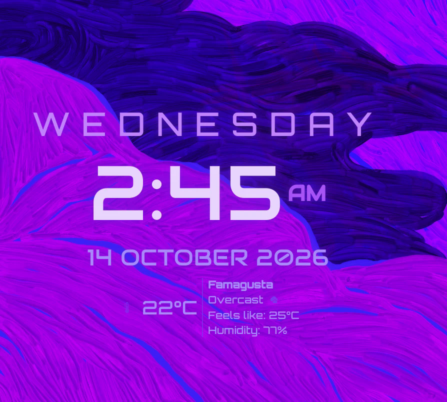

# Nyx Clock

A customizable desktop clock for KDE Plasma 6, with weekday, date and weather.



## Features

- **Layout & Format:**
  - choose the layout and alignment
  - 12 or 24 hour time, optional seconds, optional seconds progress bar
  - custom weekday and date formats, UPPERCASE switches, and a language (locale) option
- **Fonts & Sizes:** font family, weight (100–900) and size for each part (weekday, time, date, details). Resize the widget to scale everything at once.
- **Colors & Glow:** a color for each part, an accent color, an adjustable glow, and ready-made color presets. The default is a violet theme.
- **Weather:** current conditions, "feels like" and humidity from [Open-Meteo](https://open-meteo.com). It's free, with no account or API key. Search for your city in the settings. The default city is London.

## Fonts

The default look uses three free fonts from Google Fonts (all under the SIL Open Font License):

| Part | Font |
|---|---|
| Weekday | [Orbitron](https://fonts.google.com/specimen/Orbitron) |
| Time and weather details | [Quicksand](https://fonts.google.com/specimen/Quicksand) |
| Date | [Audiowide](https://fonts.google.com/specimen/Audiowide) |

[Michroma](https://fonts.google.com/specimen/Michroma) is a nice optional extra. Without these fonts the clock still works but falls back to your system font. You can also pick any installed font in **Fonts & Sizes**.

Install all four for your user (no root needed):

```bash
mkdir -p ~/.local/share/fonts/google && cd ~/.local/share/fonts/google
for f in "orbitron/Orbitron%5Bwght%5D.ttf" "quicksand/Quicksand%5Bwght%5D.ttf" "audiowide/Audiowide-Regular.ttf" "michroma/Michroma-Regular.ttf"; do
  curl -fLO "https://raw.githubusercontent.com/google/fonts/main/ofl/$f"
done
fc-cache -f
```

Then restart Plasma (`systemctl --user restart plasma-plasmashell`) so the clock picks them up.

## Install

**From the KDE Store:** right-click your desktop → **Add or Manage Widgets…** → **Get New Widgets…** → **Download New Plasma Widgets…**, search for **Nyx Clock** and click **Install**. Or download it from its [KDE Store page](https://store.kde.org/p/2378515).

**From GitHub:**

```bash
git clone https://github.com/OthrineTM/nyx-clock.git
kpackagetool6 --type Plasma/Applet --install nyx-clock/package
```

Then right-click your desktop → **Add or Manage Widgets…**, search for **Nyx Clock**, and drag it onto the desktop. Right-click the clock → **Configure Nyx Clock…** to set your city.

**Update:** `git pull`, then `kpackagetool6 --type Plasma/Applet --upgrade nyx-clock/package`, then `systemctl --user restart plasma-plasmashell`.

**Remove:** `kpackagetool6 --type Plasma/Applet --remove io.github.othrinetm.nyxclock`

## License

GPL-3.0-or-later. See [LICENSE](LICENSE). Weather data by [Open-Meteo.com](https://open-meteo.com) (CC BY 4.0).
